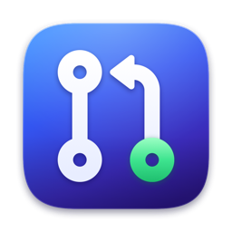
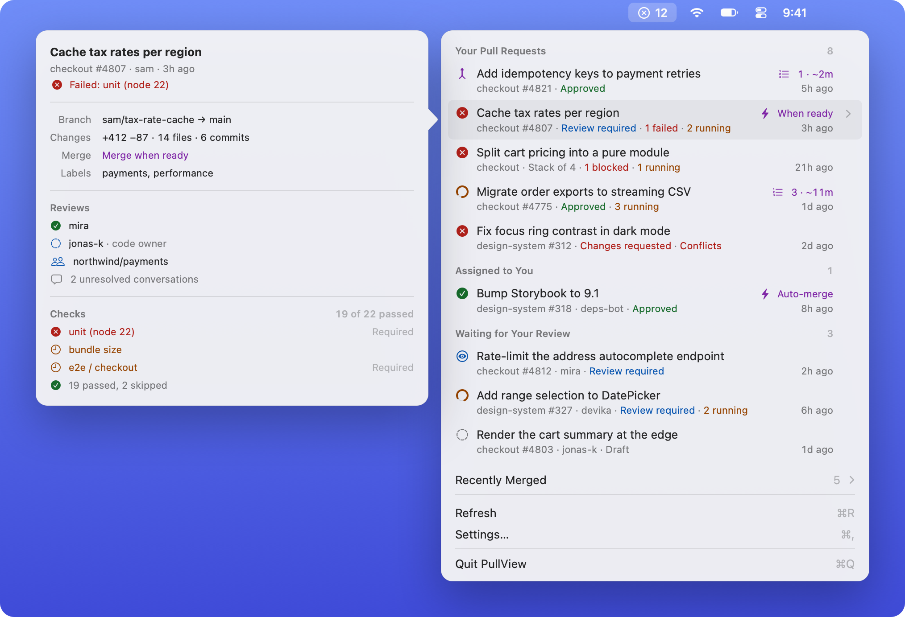
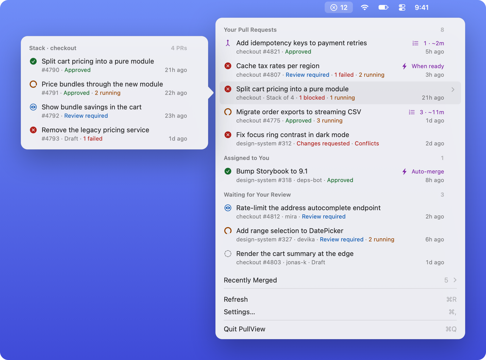

<p align="center"></p>

# PullView

A macOS menu bar app that lists your open GitHub pull requests in 3 sections: Your Pull Requests, Assigned to You, and Waiting for Your Review.
Each PR shows its review decision, CI checks, merge queue position and ETA, auto-merge or "merge when ready", native GitHub stack position, and conflicts.
Hovering a row shows a chevron that lists its failing and running checks, the branch, and the PRs in its stack.

<picture>
  <source media="(prefers-color-scheme: dark)" srcset="docs/details-dark.png">
  
</picture>

PRs in a GitHub stack share one row, which opens the stack in merge order.

<picture>
  <source media="(prefers-color-scheme: dark)" srcset="docs/stack-dark.png">
  
</picture>

The screenshots show sample data.

Requires macOS 14 or newer on Apple silicon.

## Install

```sh
brew install --cask philippgerard/tap/pullview
```

Releases are signed with a Developer ID and notarized by Apple.

## Sign in

PullView reads your token from the [GitHub CLI](https://cli.github.com) by default, so run `gh auth login` once.
`GH_TOKEN` or `GITHUB_TOKEN` override it when set.
To skip the CLI, open Settings (⌘, in the popover), choose Account, and paste a classic personal access token with the `repo` and `read:org` scopes.
PullView stores that token in your keychain.

Settings also sets the refresh interval (30 s to 10 min, default 1 min) and opening at login.
Recently Merged lists your PRs merged in the last 1 to 7 days (Settings, default 3), grouped by stack.

## Build from source

```sh
./scripts/bundle.sh          # build/PullView.app, signed ad hoc
open build/PullView.app
```

```sh
swift test                                   # offline decoding and status tests
PULLVIEW_LIVE=1 swift test --filter live     # one real fetch with your token
PULLVIEW_SCREENSHOTS=docs swift test --filter screenshots   # redraw the README screenshots from sample data
```

## Release

`scripts/release.sh X.Y.Z` runs the tests, signs and notarizes the app, publishes a GitHub release, and bumps the cask in [philippgerard/homebrew-tap](https://github.com/philippgerard/homebrew-tap).
It needs a Developer ID certificate in the keychain and a notarytool profile named `pullview-notary`.

## License

MIT, see [LICENSE](LICENSE).
